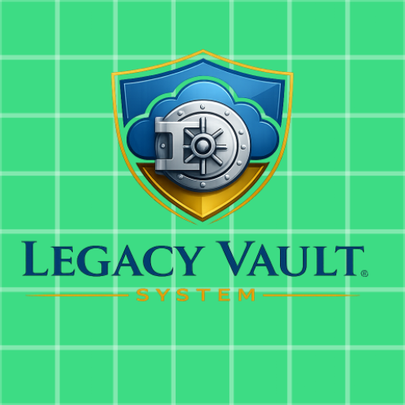

# Legacy Vault System - Digital Estate Management Application



## 📌 Executive Summary & Purpose of the App

**Legacy Vault System** is a secure, personal digital estate planning Android application designed to help users manage, protect, and organize their digital legacy for their designated executors and loved ones. In today's digital era, individuals accumulate significant online digital footprints—including financial accounts, social media profiles, domain names, personal documents, and crypto wallets. Without proper estate planning, these assets can become permanently lost, locked, or misused after an individual's passing.

The **Legacy Vault System** solves this critical problem by providing a central, encrypted repository where users can:
1. **Record Digital Assets**: Safely store online account credentials, password hints, and specific post-mortem directives (*Transfer to Executor*, *Delete Account*, *Memorialize*).
2. **Vault Critical Documents**: Securely upload and categorize legal wills, property deeds, identity papers, medical directives, and life insurance policies.
3. **Designate Digital Executors**: Assign trusted contacts with tailored access levels (*Full Access*, *Legal & Financial*, *Documents Only*, *Limited*) and primary contact markers.
4. **Define Legacy Instructions**: Write prioritized instructions (*High*, *Medium*, *Low*) guiding executors through estate settlement step-by-step.
5. **Real-Time System Administration**: Provide administrators with a live console to manage registered accounts, audit vault health, review executor access requests, and generate system compliance reports.

---

## 🎨 Design Considerations & Technical Architecture

### 1. Architectural Pattern: MVVM (Model-View-ViewModel)
The app is constructed using **Kotlin** following modern Android Architecture Components:
* **View Layer (Activities & Fragments)**: Uses Android ViewBinding for type-safe layout interactions and `activityViewModels` for shared state management.
* **ViewModel Layer (`VaultViewModel`)**: Encapsulates business logic, retains state across configuration changes, and exposes `LiveData` streams observed by UI components.
* **Model Layer (`Models.kt`)**: Strongly typed data models (`DigitalAsset`, `Document`, `Executor`, `Instruction`, `Activity`) defining data structures.

### 2. UI/UX Design System
* **Material Design 3 Components**: Implemented Material Cards, TextInputLayouts with Floating Labels, Material Buttons, and TabLayouts.
* **Color Palette**:
  * **Primary Navy**: `#0A1931` (Conveys trust, security, and professionalism)
  * **Accent Gold**: `#D4AF37` (Highlights primary actions and indicators)
  * **Background Light**: `#F8F9FA` (Clean, high-contrast readability)
* **Responsive Layouts**: **100% ScrollView Coverage** — every single screen and dialog is wrapped in `ScrollView` or `NestedScrollView` with `android:fillViewport="true"`. This prevents text clipping, accommodates soft keyboards, and eliminates button/title overlaps across all phone screen sizes.

### 3. Security & Input Validation Considerations
* **Server-Side Password Encryption**: Firebase Authentication manages user credentials using PBKDF2/scrypt encryption algorithms on Google Cloud servers.
* **Strict Email Validation (`isValidStrictEmail`)**: Enforces strict format validation using regex (`^[A-Za-z0-9._%+-]+@[A-Za-z0-9.-]+\.[A-Za-z]{2,}$`) and checks domain structure to explicitly block malformed or numeric domain addresses (e.g. `liftarke@1.com`).
* **Role-Based Routing**: Strict separation between regular user dashboards (`DashboardActivity`) and administrative controls (`AdminActivity`).
* **Email Verification (`sendEmailVerification`)**: Automated email verification link dispatching upon user registration, accompanied by live verification status badges (`Verified ✔` / `Unverified ⚠️`) in settings.

---

## 🛠️ Utilisation of GitHub & GitHub Actions

### GitHub Repository Workflow
The project is version-controlled on GitHub using a structured Git workflow:
* **Main Branch (`main` / `master`)**: Production-ready codebase.
* **Feature Commits**: Incremental, descriptive commits tracking modular additions (Auth, ViewModel, Layouts, Admin Console, Unit Tests, CI/CD).

### GitHub Actions CI/CD Pipeline
Continuous Integration is configured in `.github/workflows/android.yml`. On every `push` or `pull_request` to `main`/`master`, GitHub Actions automatically spins up an Ubuntu cloud runner to perform the following pipeline steps:

```yaml
name: Android CI/CD Build & Test

on:
  push:
    branches: [ "main", "master" ]
  pull_request:
    branches: [ "main", "master" ]

jobs:
  build-and-test:
    runs-on: ubuntu-latest

    steps:
    - name: Checkout Repository
      uses: actions/checkout@v4

    - name: Set up JDK 17
      uses: actions/setup-java@v4
      with:
        java-version: '17'
        distribution: 'temurin'
        cache: gradle

    - name: Grant Execute Permission for Gradlew
      run: chmod +x gradlew

    - name: Run Automated Unit Tests
      run: ./gradlew testDebugUnitTest

    - name: Build Debug APK
      run: ./gradlew assembleDebug

    - name: Upload Debug APK Artifact
      uses: actions/upload-artifact@v4
      with:
        name: app-debug-apk
        path: app/build/outputs/apk/debug/app-debug.apk
```

#### Pipeline Highlights:
1. **Automated Testing**: Executes `./gradlew testDebugUnitTest` across all 13 unit tests (`AuthValidationTest`, `DataModelTest`, `VaultSecurityTest`, `CurrencyApiServiceTest`).
2. **Automated Build**: Compiles `./gradlew assembleDebug` to ensure the project builds without errors.
3. **Artifact Publishing**: Uploads the generated `app-debug.apk` directly to GitHub Actions artifacts for seamless review and deployment.

---

## 🚀 Release Notes - Updates Since Prototype

### 🌟 Innovative Features Added in Version 2.0

#### 1. Single Sign-On (SSO) Integration
* Integrated Google Sign-In (`play-services-auth:21.2.0`) combined with Firebase Auth (`GoogleAuthProvider`).
* Added "Sign in with Google" buttons on Login (`activity_login.xml`) and Register (`activity_register.xml`) screens.

#### 2. Automated Email Verification System
* Integrated `auth.currentUser?.sendEmailVerification()` automatically upon user registration.
* Added live verification status badge (`Email Verification Status: Verified ✔ / Unverified ⚠️`) and a "Resend Verification Link" button in `SettingsFragment`.

#### 3. Strict Input Security Validation (`isValidStrictEmail`)
* Added custom domain regex validation in `RegisterActivity` and `LoginActivity` blocking fake numeric domains (e.g., `liftarke@1.com`) and displaying error feedback.

#### 4. Real-Time Admin Console & User Management
* **Live User Listing**: Queries Cloud Firestore (`db.collection("users")`) in real-time.
* **Instant User Search**: Filter users dynamically by name or email.
* **Account Control**: Admin can click **"Suspend User"** / **"Activate User"** to toggle user status (`Active` ↔ `Suspended`) live in Firestore, or edit registered profile details.

#### 5. Interactive System Audit Reports Generator
* Built `AdminReportsFragment` allowing administrators to generate real-time on-demand audit reports (*User Growth & Activity Report*, *Vault Storage & Security Report*, *Estate Access Request Audit*, *Full System Audit Report*).

#### 6. Access Request Workflow
* Real-time executor access request management in `AdminAccessRequestsFragment`.
* Clicking **Approve** updates status to **Accepted** (Green badge), while clicking **Reject** updates status to **Declined** (Red badge) live in Cloud Firestore.

#### 7. Live REST API Integration (`CurrencyApiService`)
* Connects to `Open Exchange Rates REST API` (`open.er-api.com`) in background threads using `HttpURLConnection` and `JSONObject` parsing, supported by fallback caching.

#### 8. Layout Overhaul & ScrollView Standardization
* Re-architected all headers and wrapped **100% of screens** in `ScrollView` / `NestedScrollView` to resolve text overlaps and guarantee responsive scrolling on all device sizes.

---

## 🧪 Automated Unit Test Suite

Run unit tests locally via Gradle:
```bash
./gradlew testDebugUnitTest
```

### Test Coverage (13 Tests Passing):
1. `testInvalidNumericDomainEmail_ReturnsFalse`: Verifies `liftarke@1.com` is rejected.
2. `testValidEmail_ReturnsTrue`: Verifies `user@example.com` passes.
3. `testEmptyEmail_ReturnsFalse`: Verifies empty inputs fail.
4. `testPasswordTooShort_ReturnsFalse`: Verifies length < 6 fails.
5. `testValidPassword_ReturnsTrue`: Verifies valid passwords pass.
6. `testDigitalAssetCreation`: Validates asset data mapping.
7. `testDocumentCreation`: Validates document data mapping.
8. `testExecutorCreation`: Validates executor relationships and primary status.
9. `testInstructionCreation`: Validates priority directives.
10. `testAccessLevelPermissions`: Verifies executor permission levels.
11. `testInstructionPrioritySorting`: Verifies priority filtering.
12. `testCurrencyRatesFallback`: Verifies REST API offline fallback structure.
13. `testAuthUserMapping`: Verifies user profile data structure.

---

## 🗄️ DBMS Schema (Google Cloud Firestore)

* `users/{userId}`: `uid`, `fullName`, `email`, `phone`, `idNumber`, `status`, `role`, `createdAt`, `lastLogin`
* `users/{userId}/assets/{assetId}`: `name`, `platform`, `category`, `username`, `passwordHint`, `url`, `actionAfterDeath`, `timestamp`
* `users/{userId}/documents/{documentId}`: `title`, `category`, `fileName`, `description`, `notes`, `timestamp`
* `users/{userId}/executors/{executorId}`: `name`, `relation`, `email`, `phone`, `accessLevel`, `isPrimary`, `timestamp`
* `users/{userId}/instructions/{instructionId}`: `title`, `content`, `type`, `priority`, `timestamp`
* `users/{userId}/activities/{activityId}`: `title`, `subtitle`, `date`, `iconType`, `timestamp`
* `access_requests/{requestId}`: `title`, `details`, `status`, `timestamp`
* `broadcast_notifications/{notificationId}`: `title`, `message`, `date`, `timestamp`

---

## 📄 License
This project is developed for educational purposes under the IIE Module Guidelines.
